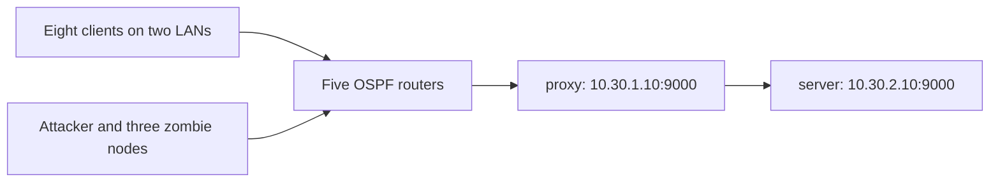

# Example configurations

[Project overview and setup](../README.md) · [YAML reference](../docs/configuration.md)

Generate a configuration by its filename stem, or pass the YAML path explicitly.
The directory created under `labs/` uses the **`lab_name` inside the YAML**, which
can differ from the filename.

| Configuration argument | Generated lab name | Nodes | Purpose and current status |
| --- | --- | ---: | --- |
| `Test1` | `test` | 3 | Two hosts and one router. A small starting point for generation and connectivity. The description mentioning 2,000 nodes does not describe the actual topology. |
| `multi-area` | `Test1_multi_area` | 10 | Four clients, five OSPF routers, and a server; areas 0, 10, 20, and 30. Validates, but its `services` block does not start the service. |
| `multi_AS` | `multi-AS` | 8 | Four hosts and four eBGP routers in AS 65001–65004. Use for routing experiments. |
| `dos_lab` | `dos_lab` | 18 | Eight clients, five OSPF routers, an attacker, three zombies, and a directly reachable server. Use with `simulate.sh`. |
| `mitigation` | `mitigation` | 19 | The load-test topology with a public TCP proxy and a private backend server. Use `--target proxy --server server`. |
| `client-router-server` | No valid lab generated | — | Unfinished placeholder: `nodes` is empty, so validation fails. |

The five populated configurations pass the current semantic validator. This
checks declarations; it does not establish runtime reachability or start services.
`simulate.sh`, including its baseline mode, requires an attacker, at least one
`zombie*` node, and their scripts, so it is intended for `dos_lab` and `mitigation`.
Use Katharà and `run_connection_tests.py` separately for other topologies.

## Node files

The generator's `--import-dirs` option copies directories whose names match nodes
in the selected YAML:

| Directory | Files used by the examples |
| --- | --- |
| `server/` | Menu-based TCP service and its CSV metrics helper |
| `proxy/` | TCP proxy with global and per-source connection limits; the metrics helper here is not used by the proxy |
| `attacker/` | Timed load controller, zombie address list, and additional experiment scripts |
| `zombie_1/`, `zombie_2/`, `zombie_3/` | Timed TCP connection-holding agents |

These directories are shared source assets for the example YAML files. Directories
with no matching node produce a warning and are skipped. Modify the source here
and regenerate a stopped lab to persist changes.

## Mitigation topology

The backend network `10.30.2.0/24` is not advertised by the routing core. The proxy
connects to it through its second interface, `10.30.2.1`. Clients and the load
controller should target the public proxy address. Server metrics still describe
the backend's connections and resources.

Although the configuration calls this a rate-limiting proxy, the implementation
limits **concurrent connections**, not requests per second. Its defaults allow
two active connections per source IP and 32 globally. See
[service settings](../docs/running-experiments.md#service-and-proxy-settings).
